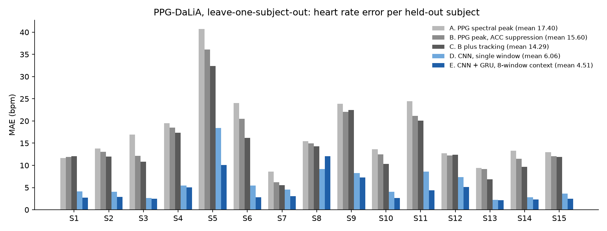
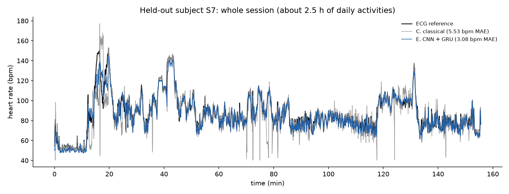

# Heart rate from wrist PPG and accelerometer (PPG-DaLiA)

A small, reproducible study of heart rate estimation from a wrist-worn
photoplethysmography (PPG) sensor and its 3-axis accelerometer, using the open
PPG-DaLiA dataset. Every method is evaluated on held-out subjects with
leave-one-subject-out cross-validation over all 15 subjects.

## Goal

Wrist PPG is easy to read when the wearer is still and hard to read when the
arm moves, because motion adds strong periodic components to the optical
signal. The question here is how much a compact deep model that sees both PPG
and accelerometer gains over classical spectral methods, when it is tested on
people it has never seen.

## Data and licence

- Dataset: PPG-DaLiA, Reiss, A., Indlekofer, I., and Schmidt, P. (2019).
  UCI Machine Learning Repository. https://doi.org/10.24432/C53890
- Source page: https://archive.ics.uci.edu/dataset/495/ppg+dalia (read
  2026-11-08).
- Licence, as stated on that page: "This dataset is licensed under a Creative
  Commons Attribution 4.0 International (CC BY 4.0) license." CC BY 4.0
  allows sharing and adaptation for any purpose with appropriate credit. The
  dataset's readme asks that published material reference the paper below.
- Paper: Reiss, A., Indlekofer, I., Schmidt, P., and Van Laerhoven, K. (2019).
  Deep PPG: Large-Scale Heart Rate Estimation with Convolutional Neural
  Networks. Sensors 19(14), 3079. https://doi.org/10.3390/s19143079

The data are not in this repository. Fifteen subjects (seven male, eight
female) wore an Empatica E4 on the wrist and a chest ECG for about 2.5 hours
of daily activities: sitting, stairs, table soccer, cycling, driving, lunch,
walking and desk work, with transitions between them. The S6 recording is
valid only for its first 1.5 hours (dataset readme), so S6 has fewer windows.

## Protocol

- Signals: wrist BVP (PPG) at 64 Hz and wrist 3-axis accelerometer at 32 Hz,
  upsampled to 64 Hz with a polyphase filter.
- Windows: 8 s long with a 2 s shift, as in the dataset paper; 64,697 windows
  in total.
- Ground truth: the `label` field in each subject file, which the readme
  describes as "the mean of the ECG-based instantaneous heart rate, given on a
  sliding window of 8 seconds, shifted with 2 seconds". As a check, the
  per-subject label means computed here match Table 3 of the paper (for
  example S1 74.8 bpm, S5 125.8 bpm).
- Evaluation: leave-one-subject-out over all 15 subjects. For each test
  subject, nothing from that subject is used for training, tuning or model
  selection. The metric is mean absolute error (MAE) in beats per minute over
  all windows of the held-out subject; the table reports it per subject and
  as the mean over subjects.

## Methods

**A. PPG spectral peak.** Band-pass the PPG window (Butterworth, 0.5 to 4 Hz),
apply a Hann window, take the zero-padded power spectrum (0.47 bpm bins) and
return the strongest peak between 40 and 200 bpm. Nothing is fitted.

**B. PPG peak with accelerometer suppression.** The normalised accelerometer
power spectrum (mean over the three axes) is subtracted from the normalised
PPG spectrum with weight alpha, so peaks that also appear in the motion
signal are pushed down before the peak is picked. This follows the spectral
subtraction idea used by SpaMa (Salehizadeh et al., Sensors 2016), in a
simplified form. alpha is chosen from a small grid on the 14 training
subjects of each fold.

**C. B plus tracking.** As B, but the peak search is limited to plus or minus
delta bpm around the previous estimate. alpha and delta are both chosen on
the training subjects of each fold.

**D. CNN, single window.** A 1-D CNN reads the raw 8 s window (4 channels:
PPG z-scored per window, accelerometer in g). Five blocks of two
convolutions (kernel 7, batch norm, ReLU) and max pooling, with 32, 32, 64,
64 and 128 channels, then global average pooling and a linear output.
296,833 parameters.

**E. CNN + GRU, 8-window context.** The same CNN encodes each window; a
one-layer GRU (64 units) reads the embeddings of the current window and the
seven before it (22 s of signal in all) and predicts the heart rate of the
current window. The model is causal: it uses only present and past windows,
so it could run online. 334,017 parameters.

Training for D and E, per fold: 13 subjects for training, the next subject in
order (S1 to S15, wrapping round) for early stopping, the test subject for
testing. AdamW, one-cycle learning rate up to 0.002, batch size 128, 12
epochs, smooth L1 loss on standardised heart rate, random gain of 0.8 to 1.2
per channel as augmentation. The weights from the epoch with the lowest
validation MAE are used for the test subject. One seed (0), one model per
fold, no ensembling.

## Results

MAE in bpm on each held-out subject. Columns are the methods above. SD is the
population standard deviation over the 15 subjects. Source:
`results/results.csv`.

| Subject | Windows | A | B | C | D | E |
|---|---:|---:|---:|---:|---:|---:|
| S1 | 4603 | 11.67 | 11.94 | 12.03 | 4.16 | 2.74 |
| S2 | 4099 | 13.77 | 13.05 | 11.98 | 4.07 | 2.89 |
| S3 | 4367 | 16.91 | 12.13 | 10.80 | 2.61 | 2.46 |
| S4 | 4572 | 19.50 | 18.48 | 17.39 | 5.43 | 5.04 |
| S5 | 4649 | 40.71 | 36.13 | 32.37 | 18.42 | 10.07 |
| S6 | 2622 | 24.03 | 20.46 | 16.18 | 5.46 | 2.84 |
| S7 | 4668 | 8.58 | 6.17 | 5.53 | 4.56 | 3.08 |
| S8 | 4037 | 15.43 | 14.99 | 14.27 | 9.14 | 12.09 |
| S9 | 4277 | 23.88 | 22.03 | 22.44 | 8.27 | 7.30 |
| S10 | 5321 | 13.66 | 12.49 | 10.37 | 4.03 | 2.64 |
| S11 | 4521 | 24.43 | 21.12 | 20.08 | 8.61 | 4.36 |
| S12 | 3954 | 12.72 | 12.25 | 12.41 | 7.39 | 5.13 |
| S13 | 4565 | 9.40 | 9.15 | 6.90 | 2.27 | 2.18 |
| S14 | 4476 | 13.33 | 11.52 | 9.70 | 2.85 | 2.36 |
| S15 | 3966 | 12.96 | 12.04 | 11.93 | 3.65 | 2.45 |
| **Mean** | 64697 | **17.40** | **15.60** | **14.29** | **6.06** | **4.51** |
| SD |  | 7.95 | 7.02 | 6.53 | 3.94 | 2.94 |

As a floor, predicting each test subject's heart rate as the constant mean of
the 14 training subjects gives a mean MAE of 18.57 bpm. The plain spectral
peak (A) is only a little better than that on this dataset, which shows how
much daily-life motion corrupts the wrist PPG.

MAE by activity, pooled over all windows of all held-out subjects
(`results/results_by_activity.csv`). Each window takes the most frequent
activity label inside it.

| Activity | Windows | A | B | C | D | E |
|---|---:|---:|---:|---:|---:|---:|
| transition | 17515 | 21.30 | 18.90 | 16.91 | 7.69 | 5.72 |
| sitting | 4569 | 2.74 | 3.06 | 2.32 | 2.91 | 2.27 |
| stairs | 3239 | 36.59 | 32.97 | 39.27 | 17.04 | 13.45 |
| table soccer | 2310 | 28.17 | 26.83 | 26.30 | 7.88 | 4.21 |
| cycling | 3473 | 28.23 | 24.15 | 25.92 | 10.02 | 6.67 |
| driving | 6843 | 11.90 | 11.20 | 7.76 | 3.27 | 2.53 |
| lunch | 13554 | 12.74 | 11.42 | 9.48 | 3.42 | 2.59 |
| walking | 4697 | 27.26 | 23.14 | 23.99 | 9.96 | 7.36 |
| working | 8497 | 8.00 | 7.64 | 4.91 | 2.48 | 2.01 |

When the wearer sits still, all methods are close (about 2 to 3 bpm). The
gap opens with arm motion: stairs, table soccer, cycling and walking.





### Comparison with the dataset paper

Reiss et al. (2019), Table 10, "Session-wise evaluation results on the
dataset PPG-DaLiA", MAE in bpm with leave-one-session-out cross-validation
(one session per subject, so the same split as here). Values copied from the
article page at https://www.mdpi.com/1424-8220/19/14/3079 on 2026-11-08; the
full table is in `results/paper_table10.csv`.

| Method (paper) | Mean MAE ± SD |
|---|---|
| SpaMa | 15.56 ± 7.5 |
| SpaMaPlus | 11.06 ± 4.8 |
| Schaeck2017 | 20.45 ± 7.1 |
| CNN average (7 repetitions) | 8.82 ± 3.8 |
| CNN ensemble (7 repetitions) | 7.65 ± 4.2 |

Table 12 of the same paper also reports a resource-constrained CNN with 26K
parameters at 9.99 ± 5.9 bpm on PPG-DaLiA.

How to read this:

- The simple classical baselines here (B: 15.60, C: 14.29) land near the
  paper's SpaMa (15.56) and are clearly weaker than its SpaMaPlus (11.06).
  They are deliberately simple and are not a reimplementation of either.
- The single-window CNN (D, 6.06) and the CNN + GRU (E, 4.51) have lower mean
  MAE than the paper's CNN ensemble (7.65). The windows, labels and subject
  split are the same, but the models are not like for like. The paper's CNN
  reads spectra and its ensemble combines 7 trained models; the models here
  read raw signals, and E also sees the 7 previous windows. The difference
  should be read as one run of a different design, not as a controlled
  comparison.
- Later published work on PPG-DaLiA was not checked for this README, so no
  claim is made about how these numbers rank against the current state of
  the art.

## Limitations

- One training seed per fold. Fold-to-fold spread is large (E ranges from
  2.18 to 12.09 bpm), and no confidence interval over seeds was measured.
- Early stopping uses a single validation subject, which is noisy: for test
  subject S7 it picked epoch 1. A larger validation pool or a fixed epoch
  count would be more stable.
- S8 is the one subject where E is worse than D (12.09 against 9.14 bpm).
  This was not investigated further.
- Hyperparameters of the deep models (architecture, context length, epochs,
  learning rate) were set once by hand and not tuned. They were not tuned on
  test subjects either.
- Fifteen subjects from one study, one device (Empatica E4) and one protocol.
  The results say nothing about other devices, skin tones, ages or health
  conditions, and this is not a medical device.
- Model size (about 0.3 M parameters) is small but has not been checked
  against an on-device memory or energy budget; no quantisation was tried.
- The deep models were trained on the Apple MPS backend, which is not bit-for-bit
  deterministic, so a rerun may give slightly different numbers.

## Reproduce

Python 3.11; versions in `requirements.txt`. Total compute on an Apple M3 Ultra
(MPS) was about 70 minutes, almost all of it the two deep models (53 min for
E and 16 min for D over the 15 folds).

```sh
python3 -m venv .venv && .venv/bin/pip install -r requirements.txt
# Download https://archive.ics.uci.edu/static/public/495/ppg+dalia.zip (2.7 GB)
# into data/, then unzip it and the inner data.zip into data/raw/.
.venv/bin/python src/prepare.py data/raw/PPG_FieldStudy data/windows
.venv/bin/python src/baselines.py data/windows results
.venv/bin/python src/train.py data/windows results --name cnn_gru --context 8
.venv/bin/python src/train.py data/windows results --name cnn_only --context 1
.venv/bin/python src/summarize.py data/windows results figures
```

The subject files are Python pickles. `prepare.py` loads them with a
restricted unpickler that rebuilds only NumPy arrays and plain containers,
so a tampered file cannot run code.

The SHA-256 of the downloaded archive used here was
`5772387956e34e2e2dc4c2ddbeb98cb70569d5112fa4c13ee98a17680b84a1f3`.

## Layout

- `src/prepare.py`: windowing and label extraction
- `src/baselines.py`: methods A to C
- `src/train.py`: methods D and E
- `src/summarize.py`: tables and figures
- `results/`: per-subject and per-activity CSVs, the paper's Table 10, training
  logs and per-fold details (validation subject, chosen epoch)
- `figures/`: the two figures above

## Licence

The code is released under the MIT licence (see LICENSE). The dataset is not
included; it remains under CC BY 4.0 with credit to Reiss et al.
